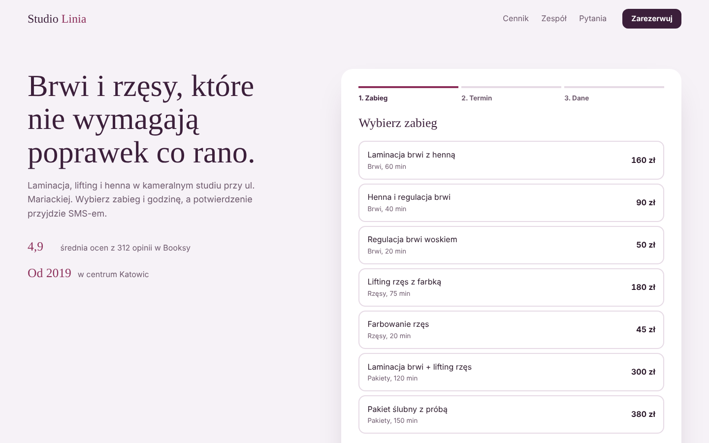

# Studio Linia: beauty salon website with online booking

**Live demo:** https://andriu-tsap.github.io/salon-booking/

Website for a brow & lash studio (concept project, fictional brand) where the booking widget is the main feature. Built for salons, barbers, physiotherapists and any business that books appointments.

## Features
- **3-step booking flow:** service → specialist → day and time → contact details, with a progress bar
- **Calendar strip** for the next 3 weeks (Sundays closed) and **time slots** that depend on the service length and the salon's closing time
- Realistic demo availability generated deterministically per day and specialist
- **Live summary** with price and a first-visit discount (−10%)
- Validation with clear messages, confirmation screen, "book again"
- Price list and team section generated from the same data as the booking widget
- FAQ built with native `
` (works without JavaScript)
- Accessible radio groups with arrow-key navigation, visible focus, responsive layout

## Tech
HTML5 · CSS3 · vanilla JavaScript (ES6+). No dependencies. The booking logic is ready to be connected to a backend or a service like Booksy/Calendly API.

## Run locally
Open `index.html` in a browser.

---
Design and code: [Andrii Tsap](https://andriu-tsap.github.io). The brand, staff and reviews are fictional.
